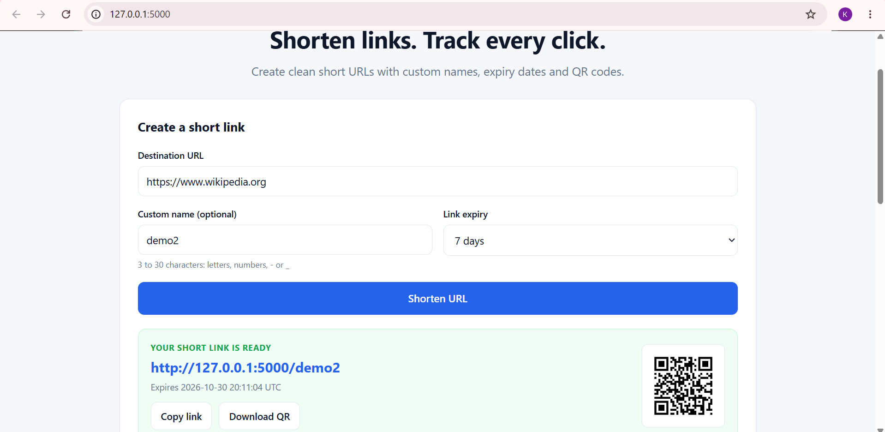
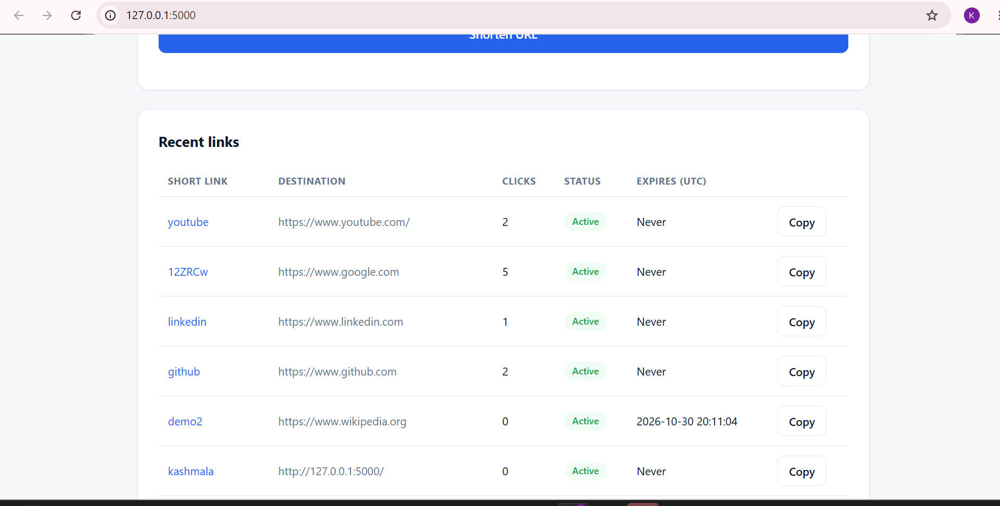
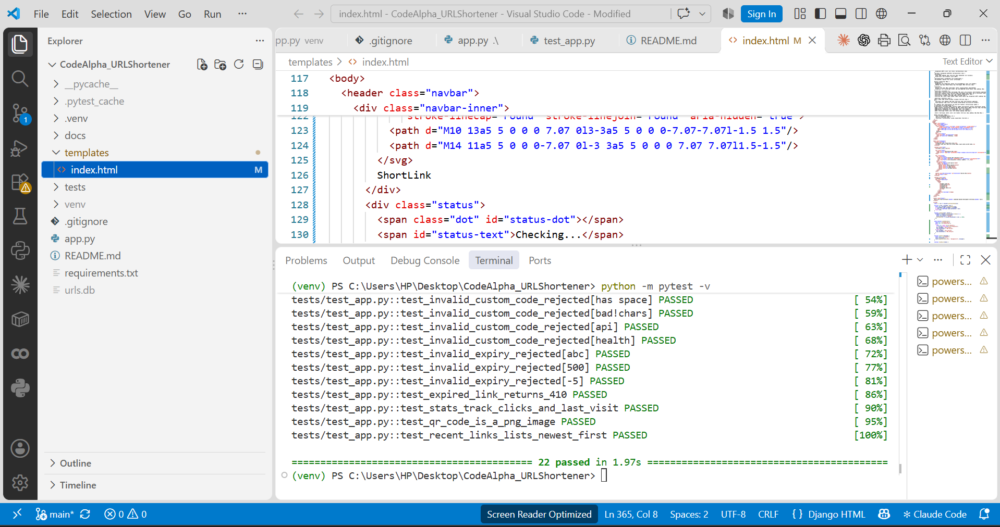

# URL Shortener

This is my Task 1 project for the CodeAlpha Backend Development Internship. It's a small web app that turns a long link into a short one, and when someone opens the short link it sends them to the original page.



## What it does

You paste a long URL, and the app gives you back a short link like `127.0.0.1:5000/aB3xY9`. Opening that link redirects to the original URL. Everything is stored in a SQLite database.

Once the core features were working, I extended the project with a few additions that I felt a real shortener should have:

- Custom names, so you can choose `/my-portfolio` instead of a random code
- Expiry dates, so a link can stop working after 1, 7 or 30 days
- A click counter and last-visit time for every link
- A QR code for each short link
- A table of recent links with a copy button
- A `/health` page that shows the server is running



## Built with

Python, Flask, SQLite, and plain HTML, CSS and JavaScript for the page. I used pytest for the tests.

## How to run it

1. Download or clone this repo.
2. Open a terminal in the project folder and create a virtual environment:
   ```
   python -m venv venv
   venv\Scripts\activate
   ```
3. Install what the project needs:
   ```
   pip install -r requirements.txt
   ```
4. Start the app:
   ```
   python app.py
   ```
5. Open http://127.0.0.1:5000 in your browser.

## API endpoints

| Method | Endpoint | What it does |
|--------|----------|--------------|
| POST | `/api/shorten` | Creates a short link. Send `url`, and optionally `custom_code` and `expires_in_days` |
| GET | `/<short_code>` | Redirects to the original URL |
| GET | `/api/stats/<short_code>` | Shows clicks, last visit and expiry for one link |
| GET | `/api/links` | Lists the 10 newest links |
| GET | `/api/qr/<short_code>` | Returns the QR code as a PNG image |
| GET | `/health` | Returns `{"status": "ok"}` |

## Tests

I wrote 22 tests that check the main things: valid and invalid URLs, custom names, expired links, click counting, the QR code and the health check. To run them:

```
python -m pytest -v
```



## Things I learned

- How a redirect works, and why I used a temporary (302) redirect. A permanent one gets remembered by the browser, so later clicks would never reach my server and wouldn't be counted.
- How to stop bad input, for example by only accepting `http` and `https` links and using `?` placeholders in SQL queries.
- How to use a virtual environment and Git properly.
- How the page talks to the backend: the browser sends the long URL to my Flask API, and the API saves it and sends the short link back.
- How to write automated tests with pytest, using a separate temporary database so the tests never touch my real data.
- How to upload a project to GitHub using Git.

## Problems I ran into

- PowerShell blocked the virtual environment from activating until I changed the execution policy.
- My code once ended up in the wrong `app.py` (inside the `venv` folder), so Python couldn't find it.
- Git wasn't installed at first, so I had to install it and restart VS Code before the commands worked.
- My first commit failed because I typed my Git email command wrong (a closing quote was missing), so nothing was uploaded until I fixed it.

## What I would add next

- User accounts, so each person only sees their own links (right now the recent links list is shared)
- A bigger database like PostgreSQL instead of SQLite
- Limits on how many links one person can create
- Automatic deletion of expired links

## About me

I'm Kashmala Farrukh, a Backend Development intern at CodeAlpha.
LinkedIn: https://www.linkedin.com/in/kashmala-farrukh-29ab3536b/